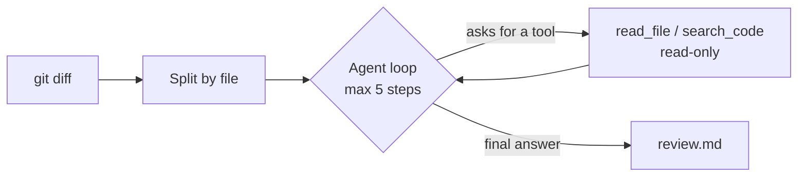

# Git Diff Review Agent

A small command-line tool that reviews your **uncommitted git changes** with an AI model.
It is a mix of a fixed workflow and an agent, and it runs on a **free** model.

- **Fixed workflow (plain code):** run `git diff`, split it by file, write the report.
  These steps are predictable, so they do not need an AI.
- **Agent (the model decides):** for each file, the model can read related files and search
  the repo before it answers. I cannot know in advance which context it needs, so this part
  is an agent loop.

## Guardrails

- Step limit: at most 5 tool rounds per file, then it stops.
- Tools are read-only. The agent can never edit, delete or run code.
- `read_file` refuses paths outside the repo, `.git`, and `.env*` files.
- Bad tool arguments, unknown tools and model errors become messages, not crashes.
- Long diffs and tool results are cut to a fixed size.

## Setup (VS Code)

1. Unzip, then in VS Code: **File > Open Folder** and choose `review-agent`.
   Accept the "install recommended extensions" prompt (Python).
2. Open the terminal with `` Ctrl+` `` and create a virtual environment:
   - Windows: `python -m venv .venv`
   - Mac/Linux: `python3 -m venv .venv`

   When VS Code asks to use the new environment, click **Yes**. Then open a new terminal
   (it should start with `(.venv)`). On Windows PowerShell, if activation is blocked, run
   `Set-ExecutionPolicy -Scope Process Bypass` once and open a new terminal.
3. Install the one dependency: `pip install -r requirements.txt`
4. Choose a free model. Copy `.env.example` to `.env`, then edit it:
   - **Local (Ollama):** install Ollama, run `ollama pull qwen2.5:7b`, keep the defaults.
   - **Free hosted API:** fill in `BASE_URL`, `API_KEY` and `MODEL` from your provider.
5. Check the plain code works, no model needed: `python test_offline.py`
   (it should print `All 7 offline tests passed.`)

## Run it

Press **F5** and pick a configuration, or use the terminal:

| Step | Terminal command | What it does |
|---|---|---|
| 1 | `python setup_practice.py` | Makes `practice/`, a tiny repo with 2 hidden bugs |
| 2 | `python review.py practice` | Reviews the changes, writes `review.md` |
| 3 | `python eval.py` | Scores the agent on 7 known cases |

Use `python3` instead of `python` on Mac/Linux if needed. To review your own project:
`python review.py path/to/your/repo` (it reviews changes to files git already tracks;
for a brand new file, run `git add -N <file>` first).

## Evaluation

`eval.py` builds 7 throwaway repos: 5 with a known bug and 2 harmless changes. One bug
(`swapped_arguments`) can only be found if the agent reads another file. Each run adds a
row to `eval_results.csv`. Run it once per model and fill in this table:

| Model | Bugs caught (of 5) | False alarms (of 2) | Time |
|---|---|---|---|
| _your first model_ | | | |
| _your second model_ | | | |

Scoring uses keyword matching, which is rough. It is fine for comparing models, but it can
miss a correct answer worded differently.

## Files

| File | Purpose |
|---|---|
| `review.py` | The whole tool: diff, split, tools, agent loop, report |
| `eval.py` | Known-bug test cases and scoring |
| `setup_practice.py` | Makes the practice repo |
| `test_offline.py` | Tests with a fake model (free, instant) |
| `.env.example` | Model settings template |

## Privacy

With a hosted API, your diffs and any files the agent reads are sent to that provider.
With local Ollama, nothing leaves your computer. Do not point this at private code
unless you are comfortable with that.

## Limitations and next ideas

- Small free models miss bugs and sometimes invent them; the eval table shows how often.
- Only tracked files appear in the diff.
- Next: a GitHub pull-request mode, a `run_tests` tool behind an approval prompt, and
  comparing more models.
